# AutomationMarketplace

<p align="center">
  
</p>

<p align="center">
  <a href="https://github.com/MRJonam91/AutomationMarketplace/actions/workflows/ci.yml"></a>
  <a href="LICENSE"></a>
  <a href="https://nodejs.org"></a>
  <a href="https://github.com/sponsors/MRJonam91"></a>
</p>

> **Catalogo curato di automazioni per la smart home con verifica del manifest, analisi dei rischi di sicurezza, simulazione deterministica e garanzie di rollback per Home Assistant.**

[English](README.md) · [Architettura](docs/ARCHITECTURE.md) · [Checklist di Lancio](docs/LAUNCH.md)

---

## 💡 Il Problema

Condividere e installare automazioni domotiche è spesso rischioso e frammentato:
- **Esecuzione al buio**: Script e blueprint della community controllano spesso attuatori critici (valvole termostatiche, serrature smart, condizionatori) senza limiti di sicurezza dichiarati o debouncing anti-usura.
- **Rollback inesistente**: Quando un'automazione fallisce o produce effetti indesiderati, l'utente si ritrova con termosifoni bloccati accesi o batterie scaricate senza procedura guidata di ripristino.
- **Nessuna verifica preventiva**: Finora, l'unico modo per provare un'automazione era eseguirla direttamente sull'impianto reale della propria casa.

**AutomationMarketplace** risolve tutto questo con una **specifica formale di manifest**, **valutazione automatica del rischio per gli attuatori**, **simulatore deterministico dry-run senza hardware** e **istruzioni obbligatorie di rollback** prima dell'attivazione reale.

---

## 🚀 Avvio rapido​‌​​‌‌​‌​‌​‌​​‌​​‌​​‌​‌​​​‌‌‌​​‌​​‌‌​​​‌​​‌​‌‌​‌​‌‌​​​​‌​‌‌​‌‌​‌​‌‌‌​​​​​​‌​‌‌​‌​​‌‌‌​​​​‌‌​​‌​‌​​‌‌​​‌‌​‌‌​​​​‌​​‌‌​​​‌​​‌‌​​‌​

Esegui immediatamente con Node (zero dipendenze esterne a runtime):

```bash
# Elenca le automazioni certificate nel catalogo
npx automation-marketplace list

# Ispeziona grado di sicurezza, rischi mitigati e rollback
npx automation-marketplace show thermostat-window-saver

# Simulazione deterministica dry-run (nessun dispositivo fisico toccato)
npx automation-marketplace simulate thermostat-window-saver

# Verifica che la procedura di rollback ripristini fedelmente lo stato iniziale
npx automation-marketplace test-rollback thermostat-window-saver

# Rileva conflitti e loop ricorsivi tra più automazioni attive
npx automation-marketplace check-conflicts all

# Raggruppa automazioni e helper in un Package Home Assistant unico
npx automation-marketplace bundle thermostat-window-saver,water-leak-main-shutoff -o package.yaml

# Audit di sicurezza approfondito su Blueprint o manifest esterno
npx automation-marketplace audit ./blueprint.yaml --report-md ./audit-report.md

# Esporta YAML pulito per Home Assistant pronto per l'ambiente di test
npx automation-marketplace export thermostat-window-saver > window_saver.yaml

# Esporta direttamente come Blueprint per Home Assistant
npx automation-marketplace export thermostat-window-saver --format blueprint > window_saver_blueprint.yaml

# Esporta lo JSON Schema formale Draft-07 per validazione e autocompletamento IDE
npx automation-marketplace schema > manifest.schema.json
```

---

## ✨ Funzionalità Principali

1. **Specifiche di Manifest (`AutomationManifest`)**:
   - Dichiara entità richieste, helper, versione minima di Home Assistant supportata, permessi su attuatori e integrazioni testate.
2. **Analizzatore di Sicurezza e Rischi**:
   - Riconosce attuatori critici (`climate`, `lock`, `valve`, `water_heater`).
   - Verifica la presenza di mitigazioni (es. soglie antigelo minime, debouncing del compressore della pompa di calore).
   - Calcola un voto oggettivo di sicurezza (`A+`, `A`, `B`, `C`, `F`) e la checklist pre-volo.
3. **Garanzia Obbligatoria di Rollback**:
   - Ogni automazione include disattivazione rapida d'emergenza, passi di ripristino dello stato iniziale e fallback manuale.
4. **Simulatore Deterministico di Stato**:
   - Valuta trigger, condizioni e transizioni attese su snapshot mock in pochi millisecondi, senza richiedere un hub fisico acceso.
5. **Zero Dipendenze Runtime Esterne**:
   - Implementato esclusivamente con API standard di Node.js e TypeScript.

---

## 📦 Automazioni Certificate nel Catalogo

| ID Automazione | Categoria | Target | Grado Sicurezza | Protezioni Principali |
|---|---|---|---|---|
| `thermostat-window-saver` | Clima | HA >= 2024.1.0 | `Grade C (Guarded)` | Debounce 120s compressore, blocco antigelo 12°C |
| `night-presence-soft-light` | Illuminazione | HA >= 2024.1.0 | `A+ Certified Safe` | Luminosità limitata al 15%, spegnimento dopo 90s |
| `fridge-door-alarm-guard` | Sicurezza | HA >= 2024.1.0 | `Grade B (Guarded)` | Limite notifiche 5 min, reset automatico alla chiusura |
| `water-leak-main-shutoff` | Sicurezza | HA >= 2024.1.0 | `Grade B (Guarded)` | Chiusura valvola d'emergenza a latenza zero, allarme push |
| `solar-excess-water-heater` | Energia | HA >= 2024.1.0 | `Grade A Safe` | Debounce 5 min su immissione solare, isteresi di potenza |
| `away-mode-lock-secure` | Sicurezza | HA >= 2024.1.0 | `Grade B (Guarded)` | Debounce allontanamento 3 min, verifica contatti perimetro |
| `air-quality-ventilation-boost` | Qualità Aria | HA >= 2024.1.0 | `A+ Certified Safe` | Soglia CO2 1000ppm, ripristino velocità con isteresi a 700ppm |

---

## 🛡️ Principio di Sicurezza

> **Regola dei Confini**: Non installare mai automazioni in abitazioni reali senza preventiva revisione umana dei permessi, degli effetti fisici e delle procedure di ripristino.

---

## 💖 Donazioni / Donations

Se questo progetto ti è utile, puoi sostenerne lo sviluppo e la manutenzione:

- **GitHub Sponsors**: [github.com/sponsors/MRJonam91](https://github.com/sponsors/MRJonam91)
- **Ko-fi**: [ko-fi.com/mrjonam](https://ko-fi.com/mrjonam)
- **Buy Me a Coffee**: [buymeacoffee.com/mrjonam](https://buymeacoffee.com/mrjonam)
- **PayPal**: [paypal.me/manorollo](https://paypal.me/manorollo)

---

## 📄 Licenza / License

- **Open Source**: Distribuito sotto licenza **AGPL-3.0-only** (vedi [LICENSE](LICENSE)).
- **Uso Commerciale**: Per vendor hardware, appliance domotiche proprietarie o SaaS senza vincoli di copyleft, è disponibile una [Licenza Commerciale](COMMERCIAL-LICENSE.md).
- **Contributi**: Consulta [CONTRIBUTING.md](CONTRIBUTING.md) e [CLA.md](CLA.md).
