# AutomationMarketplace

<p align="center">
  
</p>

<p align="center">
  <a href="https://github.com/MRJonam91/AutomationMarketplace/actions/workflows/ci.yml"></a>
  <a href="LICENSE"></a>
  <a href="https://nodejs.org"></a>
  <a href="https://github.com/sponsors/MRJonam91"></a>
</p>

> **Curated smart home automation catalog with manifest verification, safety risk analysis, deterministic simulation, and rollback guarantees for Home Assistant.**

[Italiano](README.it.md) · [Documentation](docs/ARCHITECTURE.md) · [Launch Checklist](docs/LAUNCH.md)

---

## 💡 The Problem

Sharing and importing smart home automations is dangerous and fragmented:
- **Blind execution**: Community scripts and blueprints often manipulate critical actuators (heaters, motorized locks, valves) without declared safety bounds or debounce safeguards.
- **Missing rollback**: When an automation goes wrong, users are left with stuck thermostats, drained batteries, or unrecoverable device states.
- **No dry-run verification**: Until now, testing an automation meant executing it directly in your physical living space.

**AutomationMarketplace** solves this with a **verifiable manifest specification**, **automated risk scoring**, **pure simulated dry-runs**, and **mandatory rollback restoration steps** before any automation touches physical hardware.

---

## 🚀 Quick start​‌​​‌‌​‌​‌​‌​​‌​​‌​​‌​‌​​​‌‌‌​​‌​​‌‌​​​‌​​‌​‌‌​‌​‌‌​​​​‌​‌‌​‌‌​‌​‌‌‌​​​​​​‌​‌‌​‌​​‌‌‌​​​​‌‌​​‌​‌​​‌‌​​‌‌​‌‌​​​​‌​​‌‌​​​‌​​‌‌​​‌​

Run instantly with Node (zero runtime dependencies):

```bash
# List verified smart home automations
npx automation-marketplace list

# Inspect safety grade, hazards, and rollback steps
npx automation-marketplace show thermostat-window-saver

# Deterministic simulated dry-run (no physical hardware touched)
npx automation-marketplace simulate thermostat-window-saver

# Export clean Home Assistant YAML ready for your test environment
npx automation-marketplace export thermostat-window-saver > window_saver.yaml
```

---

## ✨ Key Features

1. **Automation Manifest Specification (`AutomationManifest`)**:
   - Formally captures required entities, helper variables, minimum Home Assistant version, affected actuator permissions, and certified integrations.
2. **Safety & Risk Analyzer**:
   - Detects hazardous actuators (`climate`, `lock`, `valve`, `water_heater`).
   - Verifies explicit safety mitigations (e.g. frost-guard minimum thresholds, compressor debounce delays).
   - Computes an objective Safety Grade (`A+`, `A`, `B`, `C`, `F`) and pre-flight checklist.
3. **Mandatory Rollback Guarantees**:
   - Every cataloged automation contains an emergency quick-disable method, explicit state restoration steps, and manual hardware fallback guidelines.
4. **Deterministic State Simulator**:
   - Validates event triggers, conditions, and expected state transitions against mock snapshots in milliseconds without requiring a live hub.
5. **Zero External Runtime Dependencies**:
   - Built entirely on modern native Node.js APIs and pure TypeScript.

---

## 📦 Verified Catalog Highlights

| Automation ID | Category | Target | Safety Grade | Primary Safeguards |
|---|---|---|---|---|
| `thermostat-window-saver` | Climate | HA >= 2024.1.0 | `Grade C (Guarded)` | 120s compressor debounce, 12°C frost protection guard |
| `night-presence-soft-light` | Lighting | HA >= 2024.1.0 | `A+ Certified Safe` | 15% capped brightness, 90s auto-off timeout |
| `fridge-door-alarm-guard` | Safety | HA >= 2024.1.0 | `Grade B (Guarded)` | 5-minute alert rate-limit, auto-clear on close |

---

## 🛡️ Pre-Flight Safety Philosophy

> **Boundary Principle**: Never install smart home automations in live residential spaces without human review of permissions, actuator effects, and verified rollback procedures.

---

## 💖 Donazioni / Donations

Se questo progetto ti è utile, puoi sostenerne lo sviluppo e la manutenzione:

- **GitHub Sponsors**: [github.com/sponsors/MRJonam91](https://github.com/sponsors/MRJonam91)
- **Ko-fi**: [ko-fi.com/mrjonam](https://ko-fi.com/mrjonam)
- **Buy Me a Coffee**: [buymeacoffee.com/mrjonam](https://buymeacoffee.com/mrjonam)
- **PayPal**: [paypal.me/manorollo](https://paypal.me/manorollo)

---

## 📄 Licenza / License

- **Open Source**: Distribuito con licenza **AGPL-3.0-only** (vedi [LICENSE](LICENSE)).
- **Uso Commerciale**: Per integrazioni OEM, appliance domotiche commerciali o SaaS proprietari senza copyleft, è disponibile una [Licenza Commerciale](COMMERCIAL-LICENSE.md).
- **Contributi**: Consulta [CONTRIBUTING.md](CONTRIBUTING.md) e [CLA.md](CLA.md).
